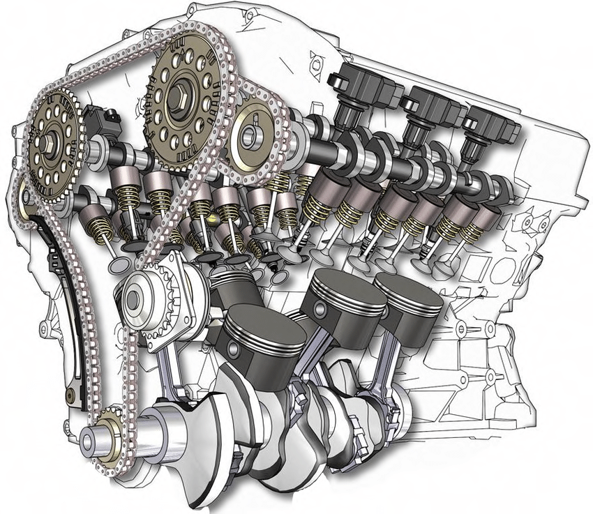

# Combustion Engines - Responsive Multi-Page Website

A four-page informational website about internal combustion engines, built with **pure HTML and CSS** (no JavaScript, no frameworks). It covers what an engine is, how the four-stroke cycle works, a timeline of the engine's history and the people behind it, and was planned from a hand-drawn wireframe before being implemented.

**Live demo:** https://armandursei.github.io/StyledWebsite/

<p align="center">
  
</p>

## Pages

| Page | Content | Layout highlights |
| --- | --- | --- |
| [Home](pages/index.html) | What a combustion engine is, six common engine types, an embedded video | CSS Grid intro and gallery, hover zoom with fading captions, responsive 16:9 video |
| [History](pages/history.html) | Timeline from Huygens' engine (1678) to the COP26 zero-emission pledge (2021) | Alternating vertical timeline built with floats and `::before` / `::after` connectors |
| [Description](pages/description.html) | Engine basics and the intake, compression, combustion and exhaust strokes | Expanding image gallery, wrapping Flexbox cards for the four strokes |
| [Notable people](pages/notable_people.html) | Otto, Maybach, Diesel, Benz, Carnot, Daimler, Barsanti, Levavasseur | Flexbox card grid going from 1 to 4 columns, links to Wikipedia |

## Features

- **Responsive layout** on every page, with media queries at 480, 600, 900 and 990 px and a mobile-first card grid (320 to 1100 px) on the Notable people page.
- **CSS-only hamburger menu**: below 900 px the navigation collapses into an animated menu driven by a hidden checkbox and the `:checked` sibling selectors.
- **Flexbox and CSS Grid** for page layouts; floats for the two-sided history timeline.
- **Expanding gallery**: hovering an image grows it with `flex` and restores colour through animated `grayscale()` / `brightness()` filters, configured with CSS custom properties.
- **Transitions and transforms** for image zoom, caption fade-in and button hover states.
- Shared header and footer styles in `global.css`, plus one stylesheet per page.

## Wireframe

The layout of each page was sketched before coding:


## Project structure

```
StyledWebsite/
├── index.html            # entry point, forwards to pages/index.html
├── pages/
│   ├── index.html        # Home
│   ├── history.html
│   ├── description.html
│   └── notable_people.html
├── styles/
│   ├── global.css        # typography, navigation, footer
│   ├── home.css
│   ├── history.css
│   ├── description.css
│   └── notable_people.css
├── media/
│   ├── images/           # general, home, history, description, notable_people
│   └── videos/home/
└── wireframe.png
```

## Running locally

No build step is needed. Open `index.html` (or `pages/index.html`) in a browser, or serve the folder:

```bash
git clone https://github.com/armandursei/StyledWebsite.git
cd StyledWebsite
python3 -m http.server 8000
# then open http://localhost:8000
```

The Raleway font is loaded from Google Fonts, so an internet connection is needed for the intended typography.

## Author

George-Armand Ursei - [GitHub](https://github.com/armandursei)
